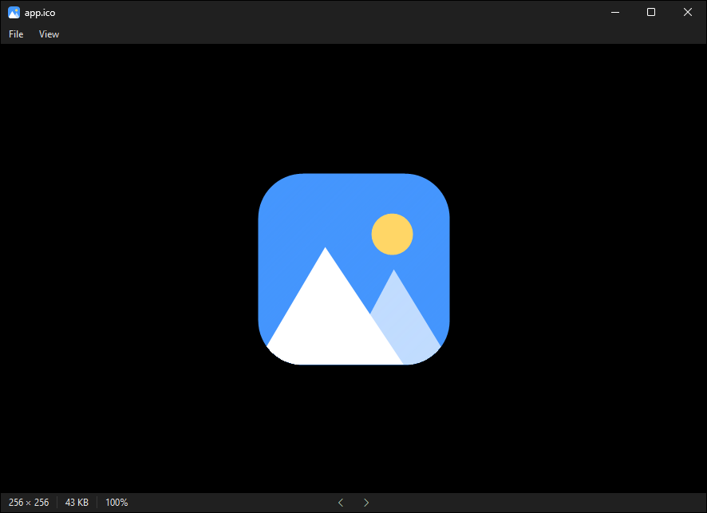

<p align="center"></p>

# ImageVIEWER

A minimal, fast, highly optimized native image viewer for Windows (Win32 + WIC + GDI) with ~1 MB idle memory usage.



## Build

Requires Visual Studio (or Build Tools) with the C++ workload. Run `build.bat`, or from a Developer Command Prompt:

```
cmake -S . -B build -G Ninja -DCMAKE_BUILD_TYPE=Release
cmake --build build
```

Output: `build\ImageVIEWER.exe` (single file, no dependencies).

## Use

```
ImageVIEWER.exe [photo.jpg]
```

| Input                    | Action                    |
| ------------------------ | ------------------------- |
| Mouse wheel / pinch      | Zoom at cursor            |
| Drag                     | Pan                       |
| Double-click             | Toggle fit / 100%         |
| `+` / `-`                | Zoom in / out             |
| `0` / `1`                | Fit / 100%                |
| `←` / `→`                | Previous / next image     |
| `F11`                    | Fullscreen                |
| `Ctrl+O`                 | Open                      |
| `Ctrl+C`                 | Copy image                |
| `Ctrl+V`                 | Paste image or image file |
| `Ctrl+S`                 | Save as                   |
| `Esc`                    | Exit fullscreen / close   |
| `Alt+F` / `Alt+V`        | File / View menu          |

## Set as default viewer

Put the exe where it will stay, then run:

```
ImageVIEWER.exe --register
```

This opens Settings → Default apps, where you pick ImageVIEWER. `--unregister` removes it.
